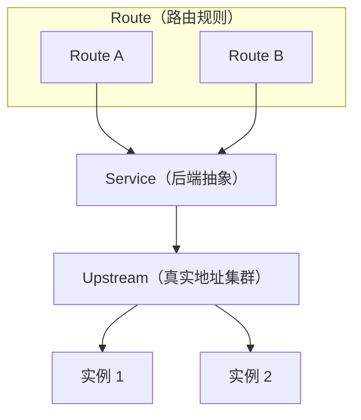
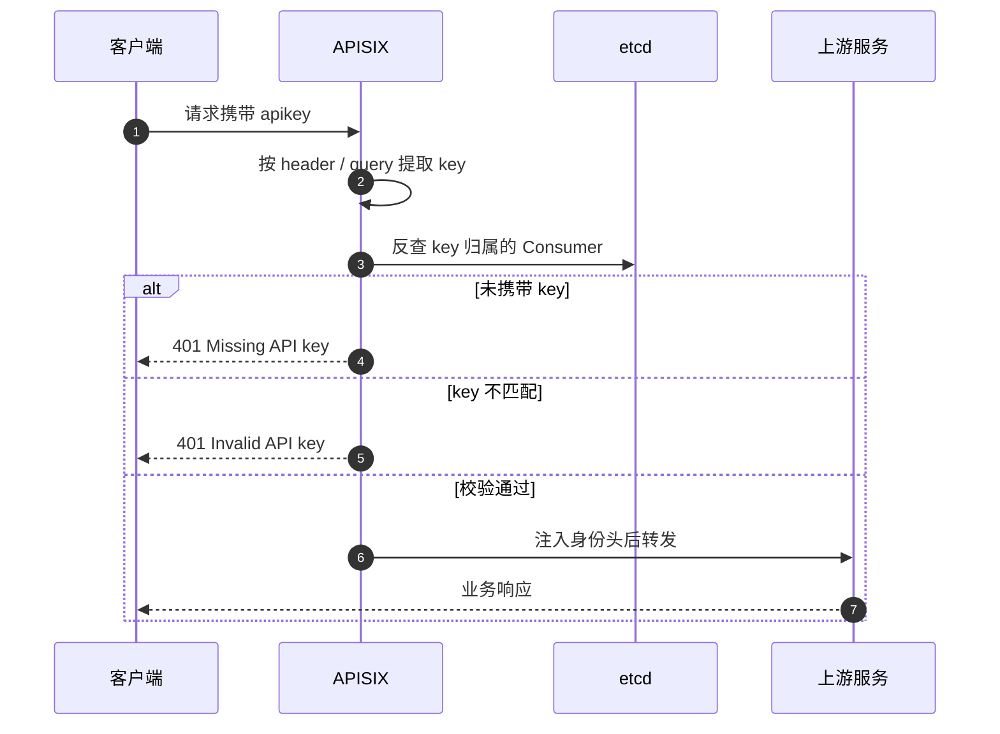

# APISIX

> 网关的通识概念、核心功能与多方案选型对比见 [API 网关](/contents/middleware/API网关.md)。

## 简介

Apache APISIX 是一个高性能、可插拔的 API 网关，设计用于管理和调度 API 及服务。它旨在简化 API 的发布和管理过程，尤其是在复杂的微服务架构中。

它是所有业务流量的入口，可以处理传统的南北向流量，也可以处理服务间的东西向流量，也可以当做 k8s ingress controller 来使用。APISIX 由深圳支流科技团队研发并且进入 Apache 基金会开始孵化。

你可以把 Apache APISIX 当做流量入口，来处理所有的业务数据，包括动态路由、动态上游、动态证书、 A/B 测试、金丝雀发布(灰度发布)、蓝绿部署、限流限速、抵御恶意攻击、监控报警、服务可观测性、服务治理等。

### 特点

1. **高性能**：基于 NGINX，因此具有处理大量请求的能力。
2. **实时性**：配置更改立即生效，无需重启服务。
3. **云原生友好**：支持 Kubernetes 集群上的部署，以及与其他云原生工具和服务的集成。
4. **插件化**：通过插件来提供多种功能，如认证、限流、熔断、日志记录等，使得扩展功能非常便捷。
5. **易用性**：提供了直观的控制台界面来管理路由、插件配置等。

### 功能

- **路由管理**：可以根据路径、域名、头信息等条件进行路由。
- **身份验证**：支持多种认证方式，如 `key-auth`（API Key）、JWT、OAuth2 等。
- **限流**：可以根据用户或请求类型限制访问频率。
- **监控**：提供详细的指标数据，帮助监控 API 的健康状态。
- **日志记录**：可以记录请求和响应的数据，便于调试和分析。

### 核心概念

#### Route（路由）

- **定义与作用**：
  - Route 是 APISIX 中最核心的概念之一。它定义了客户端请求如何被转发到后端服务。一个 Route 包含了请求的匹配规则，如请求的 URI（统一资源标识符）、请求方法（GET、POST 等）、请求头中的某些字段等。例如，你可以定义一个 Route，当客户端发送一个以 “/api/products” 开头的 GET 请求时，将其转发到后端的产品服务。
- **配置细节**：
  - 在配置 Route 时，可以指定后端服务的目标地址（可以是一个具体的 IP 地址和端口，也可以是通过服务发现机制获取的服务名称）。还可以配置一些高级选项，比如权重，用于实现负载均衡。如果有两个后端产品服务实例，你可以为它们分别设置权重，如实例 A 权重为 70%，实例 B 权重为 30%，这样 70% 的请求会被路由到实例 A，30% 会被路由到实例 B。

#### Service（服务）

- **定义与作用**：
  - Service 是对后端真实服务的抽象。它可以是一个简单的 HTTP 服务，也可以是一个复杂的微服务集群。APISIX 使用 Service 来统一管理后端服务，这样在配置 Route 时，只需要关联到对应的 Service，而不需要直接指定后端服务的复杂细节。例如，对于一个电商系统中的用户服务、商品服务和订单服务，可以分别创建对应的 Service 来代表它们。
- **配置细节**：
  - 在 Service 的配置中，可以定义后端服务的类型，如 HTTP、gRPC 等。还可以配置服务发现相关的内容，比如使用 Consul 或 Eureka 来自动发现后端服务的实例地址。此外，也可以设置一些服务层面的属性，如超时时间。如果后端服务响应时间过长，超过了设置的超时时间，APISIX 可以根据配置采取相应的措施，如返回一个自定义的超时错误信息给客户端。

#### Upstream（上游）

- **定义与作用**：
  - Upstream 用于定义后端服务的真实地址或者服务集群。当一个 Service 关联到一个 Upstream 时，APISIX 会根据 Upstream 的配置来选择具体的后端服务端点进行请求转发。在存在多个后端服务实例的情况下，Upstream 可以实现负载均衡功能。例如，在一个由多个服务器组成的后端 Web 服务集群中，Upstream 可以根据设定的负载均衡算法（如轮询、加权轮询、IP 哈希等）将请求均匀地分配到各个服务器上。
- **配置细节**：
  - 可以配置多种负载均衡算法。轮询算法会按照顺序依次将请求分配到后端的每个服务实例；加权轮询则可以根据每个实例的性能或其他因素分配不同的权重，性能好的实例可以分配更高的权重，接收更多的请求；IP 哈希算法会根据客户端的 IP 地址计算一个哈希值，保证同一客户端的请求总是被转发到同一个后端服务实例，适用于需要保持会话一致性的场景。

#### Plugin（插件）

- **定义与作用**：
  - 插件是 APISIX 实现各种功能扩展的关键组件。它可以挂载到 Route、Service 或 Consumer 上，用于实现如安全认证、流量控制、日志记录等功能。例如，通过挂载 JWT（JSON Web Token）认证插件到 Route 上，可以对访问该 Route 对应的后端服务的请求进行身份验证，只有携带有效 JWT 令牌的请求才会被允许通过。认证类插件通常需要**两侧配合**：Route 上挂插件开启校验，Consumer 上存放对应凭证。
- **配置细节**：
  - 每个插件都有自己的配置参数。以限流插件为例，可以配置每秒允许通过的最大请求数、请求突发量等参数。在 APISIX 中，可以通过管理界面或者 API 来添加、配置和删除插件。并且可以根据具体的业务需求，定制开发新的插件，以满足一些特殊的功能要求。

#### Consumer（消费者）

- **定义与作用**：
  - Consumer 是 APISIX 对**调用方身份**的抽象，代表一个使用 API 的客户端——可以是终端用户、第三方应用，也可以是内部服务。它与 Route 之间没有绑定关系，而是由认证插件在请求处理阶段"认领"：请求带着凭证进来，插件解析出它属于哪个 Consumer，后续的限流、鉴权、审计都作用在这个身份上。
- **配置细节**：
  - Consumer 以 `username` 作为唯一标识，通过 Admin API 的 `/apisix/admin/consumers` 维护。凭证（API Key、JWT 密钥、用户名密码等）直接写在它的 `plugins` 里，一个 Consumer 可以同时绑定多种认证插件——意味着同一个调用方既能用 API Key 访问，也能用 JWT 访问。
  - 同一个 Consumer 需要多把同类凭证时（例如密钥轮换期新旧并存），可以改用 Credential 子资源 `/apisix/admin/consumers/{username}/credentials/{id}` 分别存放，而不是反复覆盖 `plugins` 里那一把。
  - 这里的 `username` 就是限流插件参数里 `consumer_name` 所指的值：认证让网关先知道"你是谁"，后续的限流才能从「按 IP 计数」细化到「按调用方计数」。

> **认证的两侧配合**：Route 上挂认证插件开启校验，Consumer 上存对应凭证；插件负责把请求里的凭证翻译成一个具体身份。具体用法见后文「认证插件」。

> **请求处理链路**：请求经路由匹配、插件链加工、服务与上游定位后转发到后端实例。


> **说明**：Route 决定"转发给谁"，Plugin 决定"途中做什么"，Upstream 决定"具体打到哪个实例"。

> **Route / Service / Upstream 关系**：多个路由可指向同一服务，服务再关联到上游集群。



> **说明**：Route 是匹配入口，Service 屏蔽后端细节，Upstream 负责实例级负载均衡。

### 差异对比

#### 与 Ingress Nginx 的区别

##### 功能特性方面

1. **插件体系**
   - **APISIX**：拥有非常丰富且灵活的插件机制。它提供了大量开箱即用的插件，涵盖了从安全（如 IP 黑白名单、JWT 认证）、流量控制（限流、熔断）到监控（日志记录、链路追踪）等诸多功能。这些插件可以通过简单的配置进行挂载和使用，并且易于自定义开发新插件。例如，通过配置 APISIX 的限流插件，可以精细地控制对后端服务的请求频率，以防止服务过载。
   - **Ingress Nginx**：其插件功能相对较弱。虽然可以通过一些自定义配置和模块来实现部分插件类似的功能，但没有像 APISIX 那样完善的插件生态系统。例如，要实现复杂的流量控制功能，可能需要编写较多的自定义 Nginx 配置规则。
2. **动态配置能力**
   - **APISIX**：具有出色的动态配置更新能力。可以实时地添加、修改或删除路由、插件等配置，而无需重新启动服务。这使得在面对后端服务频繁变更（如微服务的更新迭代、服务地址迁移）的场景下，能够快速地调整网关配置，保证请求的正确转发。
   - **Ingress Nginx**：动态配置能力相对有限。在某些情况下，对配置的更新可能需要重新加载 Nginx 配置，这可能会导致短暂的服务中断。虽然可以通过一些工具和技术（如使用 Nginx - Plus 的动态模块）来减轻这种影响，但整体上动态配置的灵活性不如 APISIX。
3. **协议支持**
   - **APISIX**：支持多种协议，除了常见的 HTTP/HTTPS 外，还能很好地支持 WebSocket、gRPC 等协议。这使得它可以用于构建更加多样化的 API 服务，满足不同类型应用的需求。例如，在实时通信场景下，可以利用 WebSocket 协议支持来实现聊天应用等功能。
   - **Ingress Nginx**：主要侧重于 HTTP/HTTPS 协议的处理。虽然也可以通过一些扩展和自定义配置来支持其他协议，但对非 HTTP/HTTPS 协议的支持相对没有 APISIX 那么原生和方便。

##### 性能方面

- **APISIX**：基于 NGINX 和 LuaJIT 构建，性能较高，在处理高并发请求时表现出色。LuaJIT 的高效执行能力使得 APISIX 能够快速地处理大量请求，并且其架构设计也有利于优化请求处理流程。在高流量的互联网应用场景下，能够有效地降低请求响应时间。
- **Ingress Nginx**：本身 Nginx 性能也不错，但在处理非常高并发的复杂场景时，APISIX 可能会更有优势。因为 APISIX 的动态路由和插件处理机制在高并发情况下可以更加灵活地调整策略，而 Ingress Nginx 可能会受到其相对固定的配置加载方式的限制。

##### 适用场景方面

1. **微服务架构场景**
   - **APISIX**：非常适合复杂的微服务架构。它可以作为一个强大的 API 网关，集中管理众多微服务的入口，通过动态路由和丰富的插件对微服务进行全方位的管理，包括服务发现、流量治理、安全防护等。例如，在一个大型的微服务架构的金融系统中，APISIX 可以帮助管理用户服务、交易服务、风控服务等多个微服务的 API 访问。
   - **Ingress Nginx**：也可以用于微服务架构，但更多的是侧重于基本的 HTTP 请求路由转发功能。如果微服务架构对插件功能要求不高，主要关注简单的请求路由和负载均衡，Ingress Nginx 可以是一个合适的选择。例如，在一个小型的微服务演示项目中，使用 Ingress Nginx 来实现简单的前端请求到后端微服务的路由转发。
2. **云原生应用场景**
   - **APISIX**：是云原生架构下的理想选择。它与容器编排工具（如 Kubernetes）集成良好，可以方便地实现自动服务发现和配置更新。在云原生环境中，能够根据容器的动态变化快速调整 API 网关的配置，适应应用的动态扩展和收缩。
   - **Ingress Nginx**：虽然也在云原生领域有广泛的应用，但在与云原生特性的融合方面，如动态配置和插件功能的云原生友好性，相对 APISIX 稍显逊色。不过，由于 Nginx 的广泛认知度，在一些对传统 Nginx 配置比较熟悉的云原生场景中，仍然有其应用价值。

#### 与 Spring Cloud Gateway 的区别

##### 技术栈

- **Spring Cloud Gateway**：适用于 Java 开发者，与 Spring 生态系统紧密结合。
- **Apache APISIX**：基于 NGINX 和 Lua，适合对性能有较高要求的应用。

##### 功能丰富度

- **Spring Cloud Gateway**：通过过滤器模型提供丰富的功能，适合微服务架构。
- **Apache APISIX**：通过插件化架构提供丰富的功能，支持更广泛的使用场景。

##### 易用性

- **Spring Cloud Gateway**：对于 Spring 生态系统的用户来说，集成和使用较为方便。
- **Apache APISIX**：提供直观的 Dashboard 和 API 接口，适合需要动态配置和实时监控的应用。

##### 部署环境

- **Spring Cloud Gateway**：主要适用于 Kubernetes 和其他容器化环境。
- **Apache APISIX**：可以在多种环境中部署，包括 Kubernetes、Docker、物理机等。

##### 选择建议

- 如果你已经使用 Spring Boot 和 Spring Cloud，并且主要关注微服务架构中的 API 管理，那么 Spring Cloud Gateway 可能更适合你。
- 如果你需要一个高性能、可插拔的 API 网关，并且希望支持多种环境和协议，那么 Apache APISIX 可能是更好的选择。

### 相关插件

#### limit-req

`limit-req` 插件使用[漏桶算法](https://baike.baidu.com/item/%E6%BC%8F%E6%A1%B6%E7%AE%97%E6%B3%95/8455361)限制单个客户端对服务的请求速率。

##### 核心属性

[完整资料查看](https://apisix.apache.org/zh/docs/apisix/plugins/limit-req/)

| 名称    | 类型      | 必选项 | 有效值                                                                                       | 描述                                                                                                                                                        |
| ----- | ------- | --- | ----------------------------------------------------------------------------------------- | --------------------------------------------------------------------------------------------------------------------------------------------------------- |
| rate  | integer | 是   | rate > 0                                                                                  | 指定的请求速率（以秒为单位），请求速率超过 `rate` 但没有超过（`rate` + `burst`）的请求会被延时处理。                                                                                            |
| burst | integer | 是   | burst >= 0                                                                                | 请求速率超过（`rate` + `burst`）的请求会被直接拒绝。                                                                                                                        |
| key   | string  | 是   | ["remote_addr", "server_addr", "http_x_real_ip", "http_x_forwarded_for", "consumer_name"] | 用来做请求计数的依据，当前接受的 `key` 有：`remote_addr`（客户端 IP 地址），`server_addr`（服务端 IP 地址）, 请求头中的 `X-Forwarded-For` 或 `X-Real-IP`，`consumer_name`（Consumer 的 `username`）。 |

#### limit-conn

`limit-conn` 插件用于限制客户端对单个服务的并发请求数。当客户端对路由的并发请求数达到限制时，可以返回自定义的状态码和响应信息。

##### 核心属性

[完整资料查看](https://apisix.apache.org/zh/docs/apisix/plugins/limit-conn/)

| 名称                 | 类型      | 必选项 | 有效值                    | 描述                                                                                                                                                                                                                     |
| ------------------ | ------- | --- | ---------------------- | ---------------------------------------------------------------------------------------------------------------------------------------------------------------------------------------------------------------------- |
| conn               | integer | 是   | conn > 0               | 允许的最大并发请求数。超过 `conn` 的限制、但是低于 `conn` + `burst` 的请求，将被延迟处理。                                                                                                                                                             |
| burst              | integer | 是   | burst >= 0             | 每秒允许被延迟处理的额外并发请求数。                                                                                                                                                                                                     |
| default_conn_delay | number  | 是   | default_conn_delay > 0 | 默认的典型连接（或请求）的处理延迟时间。                                                                                                                                                                                                   |
| key                | string  | 是   |                        | 用来做请求计数的依据。如果 `key_type` 为 `"var"`，那么 `key` 会被当作变量名称，如 `remote_addr` 和 `consumer_name`；如果 `key_type` 为 `"var_combination"`，那么 `key` 会当作变量组合，如 `$remote_addr $consumer_name`；如果 `key` 的值为空，`$remote_addr` 会被作为默认 `key`。 |

#### limit-count

`limit-count` 插件使用固定时间窗口算法，主要用于限制**单个客户端**在指定的时间范围内对服务的总请求数，并且会在 HTTP 响应头中返回剩余可以请求的个数。该插件原理与 [GitHub API 的速率限制](https://docs.github.com/en/rest/reference/rate-limit)类似。

##### 核心属性

[完整资料查看](https://apisix.apache.org/zh/docs/apisix/plugins/limit-count/)

| 名称          | 类型      | 必选项 | 有效值             | 描述                                  |
| ----------- | ------- | --- | --------------- | ----------------------------------- |
| count       | integer | 是   | count > 0       | 每个客户端在指定时间窗口内的总请求数量阈值。              |
| time_window | integer | 是   | time_window > 0 | 时间窗口的大小（以秒为单位）。超过该属性定义的时间，则会重新开始计数。 |

### 认证插件

> **认证模型**：APISIX 的认证不是"一个插件搞定"，而是**两侧配合**——Route 上挂认证插件开启校验，Consumer 上存对应凭证。请求进来后插件按约定位置提取凭证、反查 Consumer，校验通过再把身份写进请求头透传给上游。

> **key-auth 鉴权链路**：提取 `apikey` → 反查 Consumer → 校验通过后注入身份头 → 转发上游。



> **说明**：认证在网关一次收口，下游服务只需信任 `X-Consumer-Username` 这类身份头，不必再实现一套密钥校验；网关也因此"看得见"调用方，能据此做精细限流与审计。

#### key-auth

`key-auth` 插件为 Route 或 Service 增加 **API Key** 认证：客户端把密钥放在请求头（默认 `apikey`）或查询串里，APISIX 校验通过才放行。它的定位是"认得出人"而非"证明得了身份"——密钥**不携带任何声明、没有内置过期时间**，网关每来一个请求都要反查一次 Consumer 才知道对方是谁。相比之下 JWT 把身份与权限写在令牌里，网关本地验签即可，不必回查。

##### 核心属性

[完整资料查看](https://apisix.apache.org/zh/docs/apisix/plugins/key-auth/)

Consumer 侧（存放凭证）：

| 名称  | 类型     | 必选项 | 有效值 | 描述                                                                                                                    |
| --- | ------ | --- | --- | --------------------------------------------------------------------------------------------------------------------- |
| key | string | 是   | 无   | Consumer 的唯一密钥，即客户端需要携带的 API Key。该字段在 schema 中标记为加密字段，写入 etcd 前会被加密；也支持用 `$secret://` 前缀引用密钥管理服务中的值。 |

Route 侧（开启校验）：

| 名称               | 类型      | 必选项 | 有效值         | 描述                                                                 |
| ---------------- | ------- | --- | ----------- | ------------------------------------------------------------------ |
| header           | string  | 否   | 默认 `apikey` | 从哪个请求头读取密钥。                                                        |
| query            | string  | 否   | 默认 `apikey` | 从哪个查询参数读取密钥，优先级低于 `header`——两者同时携带且值冲突时，以请求头为准。                     |
| hide_credentials | boolean | 否   | 默认 `false`  | 为 `false` 时，含密钥的请求头或查询串会原样透传给上游；为 `true` 时先剥离认证信息再转发。               |

> **版本说明**：更新版本的 `key-auth` 还提供 `anonymous_consumer`（允许匿名消费者绕过认证）与 `realm`（401 响应中 `WWW-Authenticate` 的域值）。本文演示环境为 APISIX 3.11.0，尚未包含这两个参数，需要时请查阅对应版本的官方文档。

##### 使用步骤

**第一步：创建 Consumer 并绑定密钥。** 凭证挂在 Consumer 上，`username` 即后续限流插件 `key: consumer_name` 的取值：

```bash
# 创建 Consumer jack，并在其 plugins 中写入 key-auth 密钥
curl -X PUT http://127.0.0.1:9180/apisix/admin/consumers \
  -H "X-API-KEY: admin-key" \
  -d '{
    "username": "jack",
    "plugins": {
      "key-auth": {
        "key": "jack-key"
      }
    }
  }'
```

> 若同一个 Consumer 需要多把密钥（如轮换期新旧并存），改用 Credential 子资源：`PUT /apisix/admin/consumers/jack/credentials/cred-1`，body 为 `{"plugins":{"key-auth":{"key":"..."}}}`，Consumer 本身只保留 `username`。

**第二步：在 Route 上启用插件。** 这条 Route 上的所有请求都会被要求携带密钥：

```bash
# 创建路由并开启 key-auth；hide_credentials 打开，避免密钥泄露到上游
curl -X PUT http://127.0.0.1:9180/apisix/admin/routes/1 \
  -H "X-API-KEY: admin-key" \
  -d '{
    "uri": "/api/user/*",
    "plugins": {
      "key-auth": {
        "header": "apikey",
        "hide_credentials": true
      }
    },
    "upstream": {
      "type": "roundrobin",
      "nodes": {"10.0.0.1:8080": 1}
    }
  }'
```

**第三步：带密钥请求验证。** 密钥既可以放在请求头，也可以放在查询串：

```bash
# 请求头方式（默认参数名 apikey）
curl -i http://127.0.0.1:9080/api/user/1 -H "apikey: jack-key"

# 查询串方式：http://127.0.0.1:9080/api/user/1?apikey=jack-key
```

认证通过后，上游会收到 APISIX 注入的身份头：

| 请求头                    | 含义                                            |
| ---------------------- | --------------------------------------------- |
| `X-Consumer-Username`  | 认证命中的 Consumer 的 `username`                    |
| `X-Credential-Identifier` | 本次命中的凭证标识；用 Credential 子资源创建时为该凭据的 `id`        |
| `X-Consumer-Custom-Id` | Consumer 上配置的 `custom_id`（若设置）                |

> 想直接看效果，可把上游换成 `httpbin.org:80`：返回体里既能确认身份头，也能观察 `apikey` 是否还残留。

##### hide_credentials 为什么要开

`hide_credentials` 默认是 `false`，意思是客户端带来的 `apikey` 会被**原样透传**给上游。这不只是"多传一个头"的问题：上游只要有访问日志、链路追踪或错误上报，密钥就会跟着落进日志系统，一旦日志被读取或外泄，等于把调用方身份一起交了出去。

| 配置      | 上游收到的内容              | 适用场景                          |
| ------- | -------------------- | ----------------------------- |
| `false` | 请求头 / 查询串中的 `apikey` 保留 | 默认值。调试期观察原始请求，或上游确实需要自行校验密钥   |
| `true`  | 密钥被剥离，只保留 `X-Consumer-*` 身份头 | 推荐。认证已在网关收口的常规业务路由            |

##### 常见错误

| 现象                                              | 原因                                              | 处置                                                        |
| ----------------------------------------------- | ----------------------------------------------- | --------------------------------------------------------- |
| 401 `{"message":"Missing API key in request"}`  | 请求未携带密钥，或携带的参数名与插件配置的 `header` / `query` 不一致    | 确认客户端发送的头名（默认 `apikey`）与 Route 上的配置一致                    |
| 401 `{"message":"Invalid API key in request"}`  | 密钥与任何 Consumer 的凭证都不匹配；或 Consumer 创建了但没绑定 `key-auth` | 用 `GET /apisix/admin/consumers` 核对用户名与密钥，确认 `key` 写在 Consumer 的 `plugins.key-auth` 里 |
| 不带密钥也能访问                                        | 插件未真正生效：Route 未启用 `key-auth`，或请求实际命中的是另一条规则更宽的路由 | 用 `GET /apisix/admin/routes/1` 核对生效配置，并检查是否有其他 Route 抢先匹配了同一 URI |
| 请求通过但上游拿不到 `apikey`                             | 配置了 `hide_credentials: true`                    | 属预期行为，改用 `X-Consumer-Username` 识别调用方                      |

##### 与 jwt-auth 的取舍

| 维度      | key-auth                        | jwt-auth                    |
| ------- | ------------------------------- | --------------------------- |
| 凭证形态    | 一串固定密钥                          | 签名令牌（JWT）                   |
| 是否携带声明  | 否，网关需反查 Consumer 才知道是谁          | 是，`sub`、`scope` 等直接写在载荷里    |
| 过期与轮换   | 无内置过期，靠手工更换 / 删除凭证              | 有 `exp`，可短有效期 + 刷新         |
| 校验开销    | 反查 Consumer（内存缓存，未命中回源 etcd）    | 本地验签，无需回查                   |
| 适用场景    | 内部服务互调、给第三方发长期 API Key          | 面向终端用户的登录态、需要携带权限声明         |

> **选型口径**：调用方是「可信的服务或长期合作方」，发一把不常变的密钥最省事；调用方是「随时会登录登出的终端用户」，用 JWT 才能避免每次请求都回查。两者也可并存——同一 Consumer 分别绑 `key-auth` 与 `jwt-auth`，Route 上同时启用后，请求带哪种凭证都能被识别。

JWT 的结构、签名验签与安全要点见 [JWT 令牌](/contents/security/JWT.md)；网关层统一的认证收敛与身份透传设计见 [API 网关](/contents/middleware/API网关.md) 的「认证与授权」小节。

### 开发 APISIX 插件

> [后端新手如何从 0 到 1 在 API 网关上开发 APISIX 插件](https://apisix.apache.org/zh/blog/2022/02/16/file-logger-api-gateway/#%E5%88%9B%E5%BB%BA%E6%9C%80%E5%B0%8F%E5%8F%AF%E6%89%A7%E8%A1%8C%E6%8F%92%E4%BB%B6%E6%96%87%E4%BB%B6)
